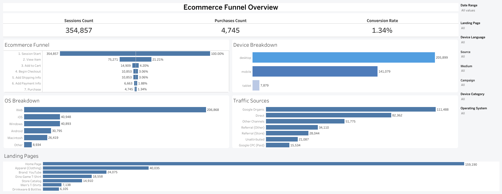

# 🛒 E-Commerce Funnel & Conversion Intelligence Dashboard

[](https://public.tableau.com/views/EcommerceFunnelOverview/EcommerceFunnelOverview)
[](sql/ga4_ecommerce_funnel_extraction.sql)
[](data/README.md)
[](LICENSE)

## 📌 Executive Summary
An end-to-end E-Commerce conversion rate optimization (CRO) and customer journey intelligence solution analyzing micro-conversion drop-offs across an enterprise-scale online store. Built on Google Analytics 4 (GA4) event-level BigQuery data (867,735 raw event logs), the project models 354,857 distinct user sessions and 4,745 completed transactions.

The business intelligence layer, developed in **Tableau**, incorporates a bidirectional symmetrical funnel architecture, acquisition channel attribution, and landing page product-level categorization, providing growth and marketing teams with granular visibility into drop-off friction points.

* **Live Interactive Dashboard:** [Tableau Public Report](https://public.tableau.com/views/EcommerceFunnelOverview/EcommerceFunnelOverview)
* **Dataset Scope:** 867,735 raw event logs consolidated into 354,857 user sessions across November 2020 – January 2021.

---

## 📊 Visualizations & Dashboard Overview



---

## 🛠 Technical Architecture & Pipeline

* **Data Engineering & Harmonization Layer (Google BigQuery):**
  * Consolidated and aligned nested event arrays via `UNNEST(event_params)` partitioned by session composite keys (`user_session_id = CONCAT(user_pseudo_id, '-', ga_session_id)`).
  * Built a two-stage Common Table Expression (CTE) architecture: CTE-1 captures session-level dimensional attributes (`landing_page`, `traffic_source`, `device`); CTE-2 isolates chronological funnel event timestamps.
  * Extracted and standardized the 7-step e-commerce journey: `session_start` ➔ `view_item` ➔ `add_to_cart` ➔ `begin_checkout` ➔ `add_shipping_info` ➔ `add_payment_info` ➔ `purchase`.
  * Sanitized irregular parameters: stripped multi-protocol domain variations (`shop.googlemerchandisestore.com`, `www.`, HTTP/S) into clean URL directories and handled null values across device parameters.

* **BI & Semantic Modeling Layer (Tableau Desktop):**
  * **Symmetrical Dual-Axis Funnel:** Engineered a bidirectional bar chart (`AGG(Sessions Count)` duplicated on Columns with left-axis `Reversed`), displaying absolute visitor counts on the left and dynamic conversion ratios (%) relative to initial sessions on the right.
  * **Non-Additive Aggregations:** Engineered accurate ratio fields (`[Conversion Rate] = 1.34%`) and configured directional Table Calculations (`Compute Using: Funnel Step`) across multi-axis layers.
  * **E-Commerce Taxonomy:** Created calculated fields (`Landing Page Clean`) with contextual Aliases mapping technical URL strings into clear catalog hierarchies (`Home Page`, `Apparel`, `Brand: YouTube`, `Dino Game T-Shirt`).
  * **Interactive Slice & Dice:** Implemented multi-select dropdown controls and cross-filtering (`Date Range`, `Landing Page`, `Source`, `Medium`, `Campaign`, `Device Category`, `Operating System`, `Device Language`) broadcasting globally (`All Using This Data Source`).

---

## 📈 Key Business Findings

* **Baseline Conversion Efficiency:** Across **354,857 total sessions**, **4,745 converted into purchases**, establishing a baseline blended Conversion Rate (CR) of **1.34%**.
* **Primary Journey Friction Points:**
  * **Top-of-Funnel Drop:** The steepest traffic loss occurs immediately after discovery — only **21.21%** of sessions advance from `Session Start` to `View Item` (a **78.79%** discovery drop-off).
  * **Consideration-to-Intent Drop:** An additional contraction occurs between product evaluation and cart addition: only **4.20%** of initial sessions trigger `Add to Cart`.
* **Checkout Micro-Conversion Resilience:** Once users initiate checkout (`Begin Checkout` at **3.06%**), intent remains stable through `Add Payment Info` (**1.88%**), with a **43.8%** finalization rate into `Purchase` (**1.34%**).
* **Traffic Driver Attribution:** Organic search (`Google Organic` with 111,488 sessions) and direct navigation (`Direct` with 82,362 sessions) dominate the traffic mix, serving as the core acquisition channels.
* **Landing Page Performance:** The `Home Page` accounts for **159,190 sessions** (~44.8% of total traffic), followed by catalog category entries `Apparel` (40k) and branded merchandising `Brand: YouTube` (24k).

---

## 💡 Strategic Recommendations

1. **Mid-Funnel Recommendation Engines:** Deploy personalized product recommendations and social proof on high-traffic landing pages (`Home Page` and `Apparel`) to increase the transition rate from browsing to `View Item`.
2. **Cart Abandonment Recovery:** Since drop-off between `Add to Cart` (14.9k) and `Begin Checkout` (10.8k) accounts for significant loss, introduce exit-intent promotional prompts and a persistent slide-in cart drawer.
3. **Paid Campaign Destination Alignment:** Route paid campaigns (`Google CPC`) directly to high-converting subcategory landing pages rather than the generic root `Home Page`.

---

## 🗂 Project Structure & Deliverables

```text
Ecommerce-funnel-conversion-analytics-tableau/
├── LICENSE                                # MIT License
├── README.md                              # Executive project overview and business findings
├── dashboards/
│   └── Ecommerce Funnel Overview.twbx     # Tableau Packaged Workbook
├── sql/
│   └── ga4_ecommerce_funnel_extraction.sql # Google BigQuery SQL extraction script
├── data/
│   └── README.md                          # Data dictionary and schema specifications
└── images/
    └── ecommerce_funnel_dashboard.png     # High-resolution dashboard view

```
---
## ✉️ Contact

**Author:** Oleksandr Hordashevskyi

- LinkedIn: [Oleksandr Hordashevskyi](https://www.linkedin.com/in/oleksandr-hordashevskyi)
- Email: [o.hordashevskyi@gmail.com](mailto:o.hordashevskyi@gmail.com)
